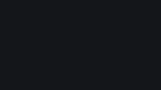
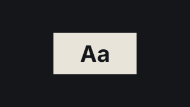
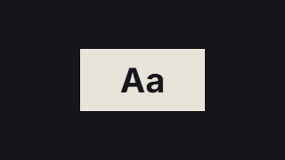
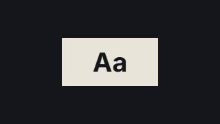
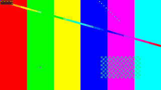
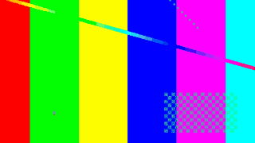
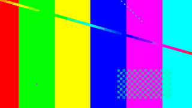
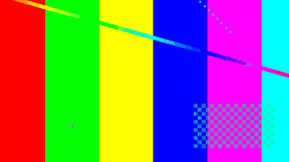
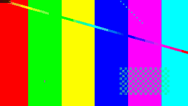
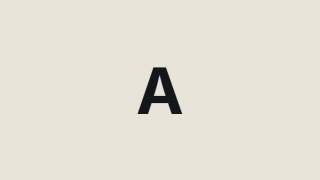

# Presets de motion

Fonte de verdade da lista de presets de `data-enter`, `data-exit`, `data-emphasis`, `data-camera` e `data-transition`. A gramática,
as faixas das chaves, os neutros e os diagnósticos estão em [`contract.md`](contract.md) §7b. Os 36 presets têm nome e valores
próprios do FrankFrames: verbos em português, `kebab-case` ASCII; o label com acento serve só à UI.

## Exemplos

Entrada, ênfase e saída no mesmo elemento. A entrada começa em 0.2 s; a ênfase começa onde a entrada termina; a
saída termina no fim do clip:

```html
<h1 data-clip-id="titulo" data-start="0" data-duration="4"
    data-enter="subir distance=24 at=0.2"
    data-emphasis="pulsar amount=1.06"
    data-exit="apagar">Olá</h1>
```

Preset com mola. `saltar` precisa de `dur` ≥ 0.59 s (o padrão de 0.7 s assenta); com `dur=0.3` o contrato dá
`E_CURVE_INVALID`:

```html
<div data-clip-id="selo" data-start="0" data-duration="3" data-enter="saltar amount=0.4 dur=0.9">Novo</div>
```

Direção e recorte. `abrir` revela na direção de `dir` e `fechar` recolhe para o lado de `dir`:

```html

```

Outra curva em todos os trechos do preset (`curve=` vale também para as curvas mistas de `saltar` e `quicar`):

```html
<div data-clip-id="aviso" data-start="0" data-duration="3" data-enter="chegar-esquerda curve=cubic-bezier(0.3,0,0.2,1)">!</div>
```

Tipografia cinética. `data-split` aplica a entrada, a saída e a ênfase do mesmo elemento a cada palavra (ou
letra), uma depois da outra; `stagger` é o intervalo entre unidades e `order` a ordem (§7b.8):

```html
<h1 data-clip-id="manchete" data-start="0" data-duration="4"
    data-split="word stagger=0.08 order=center" data-enter="subir dur=0.5">Coração, ação e emoção</h1>
<h2 data-clip-id="marca" data-start="0" data-duration="3" data-split="letter" data-enter="surgir">FrankFrames</h2>
```

Câmera em foto e em vídeo. `data-camera` move o enquadramento (zoom e foco) da imagem; sem `dur`, vai do `at` até o
fim do clip (§7b.9). Num `<video>` o movimento age sobre a `` que o substitui no render:

```html

<video data-clip-id="cena" data-start="0" data-duration="8" src="cena.mp4" data-camera="aproximar amount=1.3 fx=0.3"></video>
```

Transição entre dois clips. B entra com `data-transition` e começa antes de A terminar; a sobreposição é a duração
(§7b.10, [`transitions.md`](transitions.md)):

```html
<div data-clip-id="a" data-start="0" data-duration="4">…</div>
<div data-clip-id="b" data-start="a - 0.5" data-duration="4" data-transition="empurrar dir=left">…</div>
```

Para o que o motion não cobre (cor, stroke, largura), `@keyframes` de CSS continua valendo. Para o que nenhum
preset faz, use `data-keyframes` (§7b.7).

## Chaves

Todo preset aceita `dur` (segundos por ciclo), `at` (âncora, §7b.5) e `curve`, mais as chaves da tabela.

- `distance`: número com `px` ou `%` (sem unidade é px), com sinal; |n| ≤ 2000 px ou ≤ 200 %.
- `amount`: número; a unidade depende do preset (escala, graus, px ou opacidade) e a faixa está em §7b.4.
- `dir`: `left`, `right`, `up` ou `down`. Em `abrir`, é a direção para onde a revelação avança (`right` revela da
  esquerda para a direita; `up`, de baixo para cima); em `fechar`, é o lado para onde o recorte se recolhe.
- `repeat`: inteiro de 1 a 20 (só ênfase). A duração total é `dur × repeat`.

## Entrada

| Nome | Label | O que faz | dur | Curva | Chaves (padrão) | Miniatura |
|---|---|---|---|---|---|---|
| `surgir` | Surgir | aparece em fade | 0.5 | `suave` | — |  |
| `subir` | Subir | fade e sobe de `distance` abaixo até o lugar | 0.6 | `freio` | `distance` (32px) |  |
| `descer` | Descer | fade e desce de `distance` acima até o lugar | 0.6 | `freio` | `distance` (32px) |  |
| `chegar-esquerda` | Chegar da esquerda | fade e vem da esquerda | 0.6 | `freio` | `distance` (48px) |  |
| `chegar-direita` | Chegar da direita | fade e vem da direita | 0.6 | `freio` | `distance` (48px) |  |
| `crescer` | Crescer | fade e cresce de `amount` até 1 | 0.5 | `freio` | `amount` (0.8) |  |
| `assentar` | Assentar | fade e encolhe de `amount` (maior que 1) até 1 | 0.6 | `suave` | `amount` (1.12) |  |
| `focar` | Focar | fade e sai do desfoque de `amount` px até nítido | 0.7 | `suave` | `amount` (12) px |  |
| `girar` | Girar | fade, gira de −`amount` graus até 0 e cresce de 0.9 a 1 | 0.6 | `freio` | `amount` (12) graus |  |
| `abrir` | Abrir | revela por recorte, avançando na direção de `dir` | 0.7 | `vaivem` | `dir` (right) |  |
| `erguer` | Erguer | fade, sobe 24 px, cresce de 0.96 a 1 e sai de um desfoque de 6 px | 0.8 | `suave` | — |  |
| `saltar` | Saltar | fade (`suave`) e escala de `amount` até 1 com mola (`mola`) | 0.7 | `mola` | `amount` (0.6) |  |

## Saída

| Nome | Label | O que faz | dur | Curva | Chaves (padrão) | Miniatura |
|---|---|---|---|---|---|---|
| `apagar` | Apagar | some em fade | 0.5 | `suave` | — |  |
| `partir-cima` | Partir para cima | fade e sobe `distance` | 0.5 | `arranque` | `distance` (32px) |  |
| `partir-baixo` | Partir para baixo | fade e desce `distance` | 0.5 | `arranque` | `distance` (32px) |  |
| `partir-esquerda` | Partir para a esquerda | fade e vai `distance` para a esquerda | 0.5 | `arranque` | `distance` (48px) |  |
| `partir-direita` | Partir para a direita | fade e vai `distance` para a direita | 0.5 | `arranque` | `distance` (48px) |  |
| `recuar` | Recuar | fade e encolhe de 1 até `amount` | 0.5 | `arranque` | `amount` (0.85) |  |
| `desfocar` | Desfocar | fade e desfoca até `amount` px | 0.6 | `suave` | `amount` (12) px |  |
| `fechar` | Fechar | some por recorte, para o lado de `dir` | 0.6 | `vaivem` | `dir` (left) |  |

## Ênfase

A ênfase sai do neutro e volta a ele. Sem `at`, começa onde a entrada do mesmo alvo termina.

| Nome | Label | O que faz | dur | Curva | Chaves (padrão) | Miniatura |
|---|---|---|---|---|---|---|
| `pulsar` | Pulsar | escala 1 → `amount` → 1 | 0.6 | `suave` | `amount` (1.08), `repeat` (1) |  |
| `balancar` | Balançar | gira 0 → `amount` → −`amount` → 0 graus | 0.8 | `vaivem` | `amount` (4) graus, `repeat` (1) |  |
| `tremer` | Tremer | desloca x 0 → `amount` → −`amount` → `amount`/2 → −`amount`/2 → 0 | 0.4 | `linear` | `amount` (6) px, `repeat` (1) |  |
| `respirar` | Respirar | escala 1 → `amount` → 1, devagar | 2.0 | `vaivem` | `amount` (1.03), `repeat` (1) |  |
| `piscar` | Piscar | opacidade 1 → `amount` → 1 | 0.4 | `vaivem` | `amount` (0.2), `repeat` (1) |  |
| `quicar` | Quicar | sobe `distance` com `freio` e volta com `arranque` | 0.5 | `freio` e `arranque` | `distance` (16px), `repeat` (1) |  |

## Câmera

Só vale em `` e `<video>`. Sem `dur`, o movimento ocupa do `at` (padrão 0) até o fim do clip. `amount` fica em
[1,4]; `fx` e `fy` (foco, em [0,1], padrão 0.5) valem em `aproximar` e `afastar`; a panorâmica aceita só `fy`.

| Nome | Label | O que faz | dur de referência | Curva | Chaves (padrão) | Miniatura |
|---|---|---|---|---|---|---|
| `aproximar` | Aproximar | zoom 1 → `amount` | até o fim do clip | `suave` | `amount` (1.15), `fx`, `fy` |  |
| `afastar` | Afastar | zoom `amount` → 1 | até o fim do clip | `suave` | `amount` (1.15), `fx`, `fy` |  |
| `panoramica-esquerda` | Panorâmica à esquerda | zoom fixo `amount`; o foco vai de 0.75 a 0.25 no eixo X | até o fim do clip | `linear` | `amount` (1.12), `fy` |  |
| `panoramica-direita` | Panorâmica à direita | zoom fixo `amount`; o foco vai de 0.25 a 0.75 no eixo X | até o fim do clip | `linear` | `amount` (1.12), `fy` |  |
| `deriva` | Deriva | zoom 1.06 → 1.10 e foco (0.45, 0.48) → (0.55, 0.52), quase imperceptível | até o fim do clip | `linear` | — |  |

## Transição

Vale em `data-transition`, no clip que **entra** (B), com `data-start="<id de A> - <d>"`; A é um irmão anterior
no documento. A duração é a sobreposição `d`: o preset não tem `dur` (`dur` e `at` dão `E_MOTION_PARAM`), só
`curve` e as chaves da tabela. A coluna "dur de referência" é a sobreposição sugerida (0.5 s). B está acima de A
pela ordem do documento; só `empurrar` anima também A (§7b.10).

| Nome | Label | O que faz | dur de referência | Curva | Chaves (padrão) | Miniatura |
|---|---|---|---|---|---|---|
| `dissolver` | Dissolver | B aparece em fade sobre A | 0.5 | `suave` | — |  |
| `cortina` | Cortina | B é revelado por recorte, avançando do lado de `dir` | 0.5 | `vaivem` | `dir` (right) |  |
| `empurrar` | Empurrar | B entra do lado de `dir` e A sai empurrado para o lado oposto | 0.5 | `vaivem` | `dir` (left) |  |
| `zoom` | Zoom | B aparece em fade e assenta de 1.2 até 1 | 0.5 | `freio` | — |  |
| `iris` | Íris | B é revelado por um círculo que cresce a partir de (`fx`, `fy`) | 0.5 | `arranque` | `fx`, `fy` (0.5) |  |

## Miniaturas

As miniaturas são geradas pelo próprio engine: `node scripts/generate-motion-thumbs.ts` renderiza um cartão
"Aa" de 140×70 numa cena de 320×180 a 15 fps, com 0.3 s parados antes e depois do movimento (a saída começa visível;
a ênfase age sobre o cartão parado), e monta o GIF com o FFmpeg de `vendor/ffmpeg` (paleta de 48 cores, teto de
200 KB por arquivo; o script falha se passar). A câmera usa uma foto de teste 1280×720 (`testsrc2` do FFmpeg) em
tela cheia, 2 s de movimento. A transição usa dois cartões de tela cheia de cores diferentes (A claro, B azul), com a
sobreposição inteira entre 0.3 s de A e 0.3 s de B. `node scripts/generate-motion-thumbs.ts camera` (ou o nome de um preset) regenera só
esses. O GIF não é teste de determinismo: regenerar pode mudar bytes, o que é
aceitável. Em código, `motionThumbPath(nome)` de `@frankframes/catalog` devolve o caminho de cada uma.
